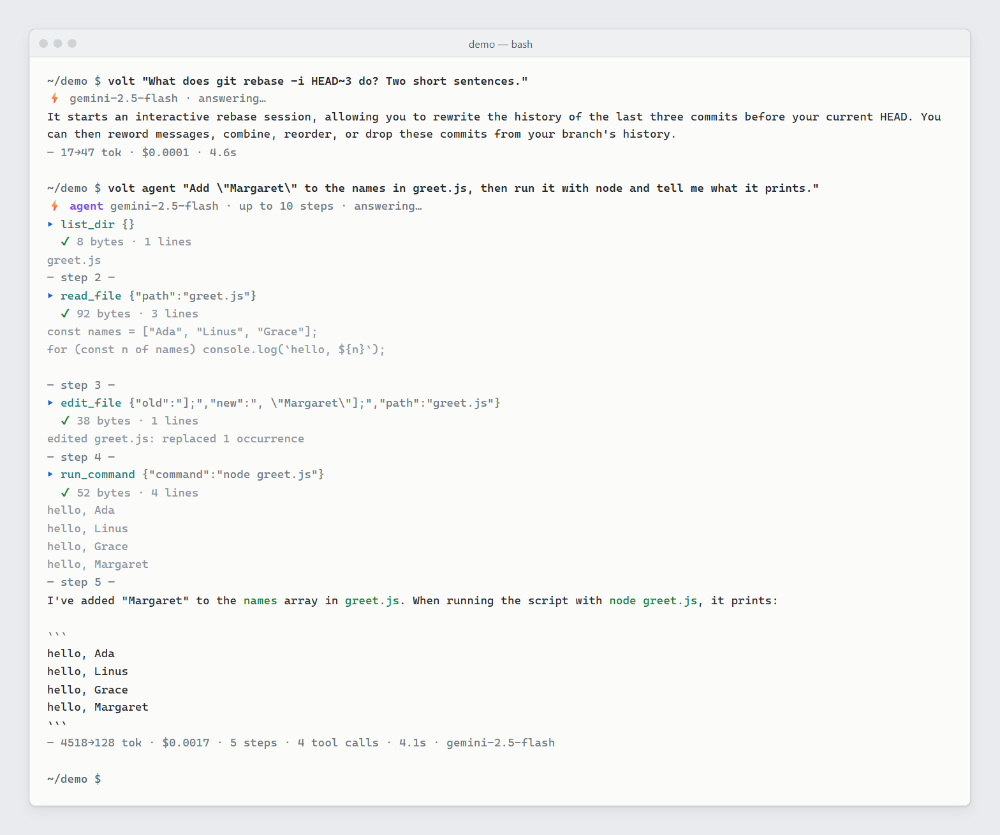

# ⚡ VOLT

**A zero-dependency AI copilot for your terminal: streaming chat, an agent mode, and a cost ledger across providers.**

VOLT is a zero-dependency CLI for talking to AI models from your terminal —
streaming, session-aware, cost-tracked, and model-agnostic. There is nothing to
install beyond Node, it streams tokens as they arrive, remembers every
conversation, and works with OpenAI, Anthropic, Ollama, Groq, OpenRouter,
DeepSeek, and anything else that speaks the OpenAI-compatible protocol.



*Real VOLT output, recolored for a light background: a streamed one-shot
answer, then `volt agent` editing a file and running it (Gemini through the
`openai_compatible` preset).*

```
$ volt "explain this in one sentence"
$ git diff | volt "review this diff"
$ volt --diff "write a commit message"
$ volt -c src/cli.js "suggest improvements"
$ volt                              # interactive session
```

---

## Requirements

- **Node.js 18 or newer.** VOLT has no npm dependencies and no build step.
- **One model source**, any of:
  - an Anthropic API key, to use Claude (see [Authentication](#authentication));
  - an API key for OpenAI, Groq, OpenRouter, DeepSeek, Mistral, Together,
    Cerebras or any OpenAI-compatible endpoint;
  - a local model server (Ollama or LM Studio).
- **git** (optional), for `--diff`, `/diff` and `volt review`.

Works on Windows, macOS and Linux.

## Install

The name `volt` is already taken on the npm registry by an unrelated package,
so VOLT is **not published to npm**. `npm install -g volt` installs something
else. Install from GitHub instead:

```bash
git clone https://github.com/Owen-Silva/volt.git
cd volt
npm install -g .          # or: npm link (keeps the install pointed at your clone)
# then, anywhere:
volt --help
```

Or in one step, straight from the GitHub repo:

```bash
npm install -g github:Owen-Silva/volt
```

To update a clone later: `git pull` (plus `npm install -g .` again if you did
not use `npm link`).

You can also run it without installing:

```bash
node volt.js --help
```

## Authentication

VOLT uses an Anthropic API key for Claude. Claude subscription sign-in is not
available yet. It will be added if Anthropic approves it; for now use an API
key.

Create a key at [console.anthropic.com](https://console.anthropic.com/settings/keys)
(it starts with `sk-ant-api`), then give it to VOLT in one of two ways. The
key is never stored in this repo.

```bash
# 1. environment variable (VOLT_ANTHROPIC_API_KEY also works and wins if both are set)
export ANTHROPIC_API_KEY="sk-ant-..."

# 2. or save it in your user config (~/.volt/config.json, outside the repo)
volt login anthropic
```

With only an Anthropic key in the environment and nothing else configured,
VOLT picks the `anthropic` provider automatically. If the key is missing,
`volt config` shows `auth: MISSING`, `volt doctor` says so, and any Claude
call stops before contacting the API with a message telling you how to set
it. Claude Code subscription tokens (`sk-ant-oat01-…`) are not API keys and
are refused by `volt login anthropic`.

## Quick start

The quickest way to sign in is `volt login` — it saves your key (masked
input), flips the provider, verifies the connection live, and picks a sensible
default model:

```bash
volt login anthropic          # sign in with your Claude API key (interactive)
volt login openai sk-...      # one-shot: any provider + key
volt logout                   # remove the saved key
```

### Merge VOLT into Claude Code

Want VOLT's features inside Claude Code itself? One command:

```bash
volt install claude
```

It installs three things (all namespaced, all removed by `volt uninstall claude`):

- **Slash commands** (`~/.claude/commands/volt-*.md`) — one per prompt template
  (`/volt-commit`, `/volt-review`, `/volt-explain`, …) plus `/volt-cost`,
  `/volt-stats` and `/volt-search` for one-key access to your unified ledger.
  Save a template anytime with `volt template save <name> "…"` and its
  `/volt-<name>` command appears in Claude Code automatically (removing it
  cleans it up).
- **A Stop hook** (`~/.claude/settings.json`) that syncs every Claude Code
  session into VOLT's ledger — so `volt cost`, `volt stats` and
  `volt search` cover Claude Code usage too, alongside VOLT's own
  conversations. Idempotent: resuming and re-stopping a session never
  double-counts. VOLT's ledger covers exactly two sources, VOLT itself and
  Claude Code; it does not read any other AI tool's data.
- **A skill** (`~/.claude/skills/volt/`) teaching Claude Code to use `volt`
  for stats, cost, search and templates.

Restart Claude Code after installing. `volt doctor` reports integration status.

**Privacy: what the hook copies.** When a Claude Code session stops, the hook
reads that session's transcript and copies the **full text** of your messages
and Claude's replies, plus model, token usage and cost, into
`~/.volt/sessions/` as plain, unencrypted JSONL (bookkeeping lives in
`~/.volt/claude/`). Nothing is sent anywhere; it stays on your disk. VOLT never
reads Claude Code's credentials.
`volt uninstall claude` removes the commands, hook and skill, but leaves
sessions that were already copied; delete them from `~/.volt/sessions/` if you
want them gone.

Prefer environment variables? That works too:

```bash
export VOLT_API_KEY="sk-..."          # OpenAI / any compatible API
# or
export ANTHROPIC_API_KEY="sk-ant-..."        # Claude
# or run a local model
export VOLT_PROVIDER=ollama           # defaults to http://localhost:11434/v1
```

Then:

```bash
volt                                     # interactive chat
volt "summarize my inbox"                # one-shot
echo "code..." | volt "explain this"     # piped context
volt --diff "review my changes"          # git-aware
volt --clip "translate this"             # clipboard-aware
```

> No key set? Run `volt doctor` for a guided diagnostic, or `volt config` to
> inspect your setup.

## Why you'll like it

- **Light by default** — zero dependencies, no build step, nothing to load but
  Node itself. (Want numbers for your setup? `volt bench` measures latency and
  time-to-first-token per provider.)
- **True streaming** — tokens render as they arrive, with live markdown and
  syntax-highlighted code blocks.
- **Efficient context** — VOLT estimates token usage, trims old turns to stay
  inside the model's context window, and shows you `in→out tok · $cost` after
  every answer.
- **Sessions for free** — every interactive conversation is persisted; resume
  with `volt --resume` or `volt chat <name>`. Sessions are plain JSONL you can
  read, script, and back up.
- **Git-native** — `--diff` and `/diff` attach your working-tree changes with
  syntax-highlighted diff blocks.
- **Model-agnostic** — switch providers mid-conversation with `/provider`.

## Commands

| command | what it does |
| --- | --- |
| `volt` | interactive chat session |
| `volt "question"` / `volt ask "question"` | one-shot answer |
| `echo x \| volt` | ask with piped input |
| `volt chat <session>` | chat, resuming a saved session |
| `volt --diff "review"` | attach git diff as context |
| `volt -c a.ts,b.ts "compare"` | attach files as context |
| `volt models` | list models the provider exposes |
| `volt doctor` | diagnose config, keys & connectivity |
| `volt config` / `volt config set <key> <value>` | inspect / change config |
| `volt sessions` / `volt sessions show <name>` | list / read sessions |
| `volt --sessions` | list sessions |
| `volt agent "task"` | autonomous agent loop (tools: shell, files) |
| `volt review` / `volt review <file>…` | structured code review (CI gate with `--gate`) |
| `volt search "query"` | full-text search across your sessions |
| `volt template list / save / show / rm` | manage prompt templates |
| `volt compare -m a -m b "…"` | one question, several models, in parallel |
| `volt bench` | latency + time-to-first-token benchmark |
| `volt context -c a.ts "…"` | dry-run: see exactly what you'd send + token budget |
| `volt tokens "text"` | instant token estimate |
| `volt completions bash\|zsh\|fish` | shell completion script |
| `volt cost` | aggregate tokens + spend across all sessions |
| `volt history` | browse recent one-shot prompts |
| `volt init` | scaffold a project `.volt.json` |
| `volt ask --continue` | one-shot follow-up on the latest session |
| `volt login [provider] [key]` | save a provider key, verify it, pick a default model |
| `volt install claude` / `volt uninstall claude` | merge VOLT's features into Claude Code (commands + usage sync) / undo |
| `volt logout` | remove the saved API key |
| `volt summarize <session>` | condense a saved session into a summary |
| `volt stats` / `stats -j` | usage dashboard: tokens, spend, per-model, activity |
| `volt upgrade --check` | check for a newer version (or how to update a source install) |
| `volt config -j` | sanitized effective config as JSON (never includes the key) |
| `volt sessions -j` | saved sessions as JSON |

## Agent mode

`volt agent` gives the model real tools and lets it work autonomously until the
task is done: it can run shell commands, read and write files, list
directories, `grep` for patterns, `glob` for files, and apply precise
search-and-replace edits, iterating up to a step budget (default 10, tune with
`--steps`).
Tool calls are logged live, the final answer streams in, and cost/usage is
summed across every step. Ctrl+C aborts mid-step. (Requires an
OpenAI-compatible provider.)

> **Warning: the agent's shell tool is not sandboxed.** The file tools
> (read, write, edit, list, grep, glob) refuse paths outside the project
> directory, but the **shell** tool runs any command the model chooses, as
> you, with your permissions, **without asking first** (via `cmd.exe` on
> Windows, `sh` elsewhere). A shell command can read, change or delete files
> anywhere you can. Only run `volt agent` in a repo you can restore (commit
> first), and never on a machine or account you can't afford to have modified.

```bash
volt agent "add error handling to src/ and run the tests"
volt agent --diff "fix the failing tests"
volt agent -j "…"          # machine-readable: {steps, toolCalls, usage, costUsd}
```

## Multimodal

Attach images to any one-shot ask (vision model required):

```bash
volt -i screenshot.png "what's wrong with this UI?"
volt compare -i a.png -i b.png -m gpt-4o -m gemini-2.5-flash "which design is better?"
```

Images become OpenAI-style `image_url` parts (png/jpg/gif/webp/svg, ≤ 8 MB);
context budgeting prices them at ~1k tokens each.

## Compare & benchmark

```bash
volt compare -m gpt-4o-mini -m gpt-4o "explain closures"
volt compare --models gpt-4o,claude-sonnet-4-5 --providers openai,anthropic "…"
volt bench            # model-list latency, round-trip, time-to-first-token
```

`compare` runs every model in parallel (up to 5) and reports each answer with
its cost and latency. `bench` shows where your time goes — great for picking a
provider. `volt context` shows exactly what would be sent (with token totals)
*before* you spend anything, and `volt tokens` estimates a string instantly.

## Plugins

Drop a `.js` file into `~/.volt/plugins/` that default-exports an object with
hooks, and VOLT loads it automatically:

```js
// ~/.volt/plugins/audit.js
export default {
  name: "audit",
  // rewrite the conversation before it's sent (all modes)
  beforeSend(messages, { model }) { return messages; },
  // transform the final response (one-shot modes; buffers the answer)
  afterResponse(content, { model }) { return content; },
};
```

Declaring `afterResponse` makes one-shot modes batch the response so the hook
can rewrite it; chat keeps streaming and only applies `beforeSend`.

## Shell completions

```bash
eval "$(volt completions bash)"      # bash
eval "$(volt completions zsh)"       # zsh (or source <(volt completions zsh))
volt completions fish | source       # fish
```

## Spending & history

Every saved conversation records tokens and cost per message, so `volt cost`
is a real spend ledger — no API calls, works offline:

```bash
volt cost             # per-model rows + totals
volt cost -j          # machine-readable
volt history          # recent one-shot prompts
volt ask --continue "and what about the edge case?"   # follow up on the latest session
volt sessions rename <old> <new>
```

## Code review & search

```bash
volt review                  # review your working-tree git diff
volt review src/a.js src/b.js
volt review --gate           # exit 1 if any critical finding (CI-friendly)
volt search "retry logic"    # find it in any past conversation
```

## Prompt templates

Built-in templates (`commit`, `review`, `test`, `explain`, `debug`, `shell`,
`improve`, `summary`) plus your own:

```bash
volt --diff --template commit "my changes"          # commit-message writer
volt -t debug -c src/cli.js "crash on startup"      # -t is temperature; use --template
volt template save pr "Summarize this PR. {prompt}"
volt template list / show <name> / rm <name>
```

Templates apply a system prompt and/or wrap your question; `{prompt}` is
replaced with what you type. In chat, `/template <name>` switches system
prompts mid-session.

## Flags

| flag | description |
| --- | --- |
| `-m, --model <name>` | model to use (e.g. `gpt-4o`, `claude-sonnet-4-5`) |
| `-p, --provider <name>` | provider preset (`openai`, `anthropic`, `ollama`, `groq`, `openrouter`, `deepseek`, `mistral`, `together`, `lmstudio`, `cerebras`, `openai_compatible`) |
| `-t, --temp <0–2>` | sampling temperature |
| `-s, --system <text>` | system prompt |
| `-c, --context <files>` | comma-separated files to attach |
| `--diff` | attach `git diff` |
| `--clip` | attach clipboard |
| `--template <name>` | apply a prompt template |
| `--steps <n>` | agent: max iterations (default 10) |
| `--gate` | review: exit 1 on critical findings |
| `-i, --image <path>` | attach an image (vision models) |
| `--models a,b` / `--providers a,b` | compare: comma lists |
| `-n, --name <name>` | session name (creates if missing, resumes if present) |
| `--resume` | resume the most recent session |
| `--new` | start a fresh, auto-named session |
| `-r, --raw` | plain text output (no ANSI / markdown) |
| `-j, --json` | machine-readable output: `{model, content, usage, costUsd, …}` |
| `--no-stream` | single response instead of streaming |
| `-q, --quiet` | suppress the usage footer |
| `-h, --help` / `-v, --version` | help / version |

Color is on by default in a terminal, off when piped or in CI. `FORCE_COLOR=1`
forces ANSI output (e.g. to pipe rendered markdown into `less -R`);
`NO_COLOR=1` always turns it off.

## Interactive commands

While chatting, type `/help` for the full list:

```
/model <name>      switch model            /temp <0–2>      temperature
/provider <name>   switch provider         /system <text>   system prompt
/attach <files…>   add file context        /diff            git diff context
/clip              clipboard context       /template        apply a prompt template
/ctx               show attached context
/unattach          drop all context        /clear           new conversation
/reset             full reset              /cost            session totals
/compact           summarize & shrink      /tokens          context-window usage
/login [prov] [key]  sign in / switch key  /logout         remove saved key
/save <name>       save session
/load <name>       load session            /sessions        list sessions
/delete <name>     delete session          /exit            quit
```

Press `Ctrl+C` once to stop a generation (partial answer is kept), twice to exit.

## Configuration

Config resolution order: **defaults → project file → user file → environment.**

- Project: `.volt.json` or `.voltrc.json` in your project (or any parent dir).
- User: `~/.volt/config.json` (edit it or use `volt config set key value`).
- Environment: `VOLT_PROVIDER`, `VOLT_MODEL`, `VOLT_API_KEY`,
  `VOLT_ANTHROPIC_API_KEY` (or `ANTHROPIC_API_KEY`), `VOLT_BASE_URL`, `VOLT_TEMPERATURE`,
  `VOLT_SYSTEM`, `VOLT_MAX_TOKENS`.

Example `~/.volt/config.json`:

```json
{
  "provider": "groq",
  "model": "llama-3.3-70b-versatile",
  "temperature": 0.4,
  "providers": {
    "groq": { "api_key": "gsk_…" }
  }
}
```

### Custom OpenAI-compatible endpoints

```bash
export VOLT_PROVIDER=openai_compatible
export VOLT_BASE_URL=http://localhost:1234/v1   # LM Studio, llama.cpp, vLLM…
export VOLT_MODEL=local-model
```

## Storage

- Sessions: `~/.volt/sessions/<name>.jsonl` (one JSON message per line)
- History: `~/.volt/history.json`
- Config: `~/.volt/config.json`
- Templates: `~/.volt/templates.json`

## Development

```bash
npm test                 # runs the full suite against a local mock API
node test/mock-server.js # stand alone mock (OpenAI-compatible, no keys needed)
```

The test suite boots a mock OpenAI-compatible server (which can also simulate
tool calls) and exercises the CLI end-to-end: streaming, piped stdin, JSON
mode, file/git/clipboard context, retries, sessions, config, agent loops,
reviews, templates, search, and error handling.

## How it works / why it's built this way

- **Zero dependencies, on purpose.** Everything is Node built-ins: global
  `fetch` for HTTP, a small hand-written server-sent-events parser for
  streaming, `child_process` for git, the clipboard and Claude Code. There is
  no `node_modules` to install, audit or break, and no build step, so the code
  you read is the code that runs.
- **Two wire formats, many providers.** Most providers speak the
  OpenAI-compatible chat API, so a provider is mostly a preset (base URL,
  default model, key name). Anthropic's native Messages API is the one other
  format, handled in the same request path. Adding a provider is usually a
  config entry, not new code.
- **Local provider extensions.** A machine can add a provider without
  touching tracked code: a gitignored `<name>.local/provider.js` at the repo
  root default-exports a small extension object (preset, `chat()`, optional
  help/login/doctor hooks) that `src/local-providers.js` loads at start-up.
  A fresh clone has none.
- **Claude through an API key, checked up front.** Claude goes through
  Anthropic's Messages API with your own key from the environment or
  `~/.volt/config.json`, never from the repo. A missing key is caught before
  any request, so you get "set ANTHROPIC_API_KEY" instead of a bare 401.
  Subscription sign-in is not available yet (see [Authentication](#authentication)).
- **Plain files as the database.** Sessions are JSONL, one message per line,
  each carrying its own token usage and cost. `volt cost`, `stats`, `search`
  and `history` are just reads over those files, so they work offline and you
  can inspect or script them yourself.
- **Context budgeting before the call.** Token counts are estimated locally
  and old turns are trimmed to fit the model's window, so a long chat degrades
  gracefully instead of failing with a context-length error.
- **Claude Code integration through its own extension points.** `volt install
  claude` uses only Claude Code's documented slash-command files, a Stop hook
  in `settings.json` (merged into your existing settings, not replacing them)
  and a skill. Every file is
  namespaced `volt-*` and `volt uninstall claude` removes them.
- **Tested end-to-end against a mock.** `npm test` runs the real CLI against a
  local OpenAI-compatible mock server (and a fake `claude` CLI), so the suite
  needs no keys and no network.

## License

MIT. See [LICENSE](LICENSE).

Issues welcome; pull requests are not accepted right now.
